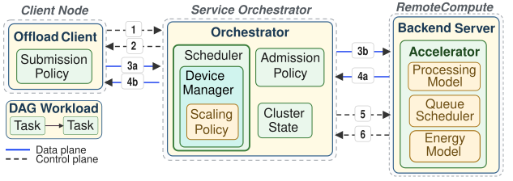

# ns-3 Continuum

ns3-continuum is an new module for ns-3 network simulator and is designed to model and simulate AI workload (e.g., Extended Reality (XR), autonomous robotics, or UAV systems, ...) offloading across edge and multi-tier computing environments! 

## ns-3 Continuum Architecture 


**Composite AI Workloads:** Workloads modeled as Directed Acyclic Graphs (DAGs) to capture complex, multi-stage inference pipelines.

**Configurable Offloading Client:** Flexible task generation behavior with integrated application-performance tracing (task completion latency, deadline misses).

**Workload Orchestrator:** Dynamic compute-resource scheduling decisions across edge, cloud, and local nodes.

**Hardware Accelerators:** Processing emulation for heterogeneous tasks (e.g., computer vision pipelines, LLM inference), featuring GPU implementation supporting dynamic voltage frequency scaling.

## ns-3 Continuum paper 
J. Mullan and A. H. Zahran, “[ns3-continuum: Bridging Network and Compute Simulation for Distributed Computing Systems](ns3-continuum-CNSM2026.pdf),” in Proc. 22nd Intl. Conf. on Network and Service Management, Alcalá de Henares (Madrid), Spain, 26–30 October, 2026.

## Build Commands

```bash
./ns3 configure --enable-examples --enable-tests  # Configure
./ns3 build                                        # Build
./test.py -s continuum                             # Run module tests
./ns3 run continuum-example                        # Run example
```

## Development Dockerfile
```bash
git clone --branch main --single-branch https://github.com/MullanJohn/ns3-distributed.git
cd ns3-distributed
docker build -f Dockerfile.dev -t continuum-dev .
docker run -it -v "$(pwd)":/workspace/ns-3-dev/contrib/continuum continuum-dev
```

## Evaluation Dockerfile
```bash
git clone --branch evaluation --single-branch https://github.com/MullanJohn/ns3-distributed.git
cd ns3-distributed
docker build -f Dockerfile.eval -t continuum-eval .
docker run -it continuum-eval
```
